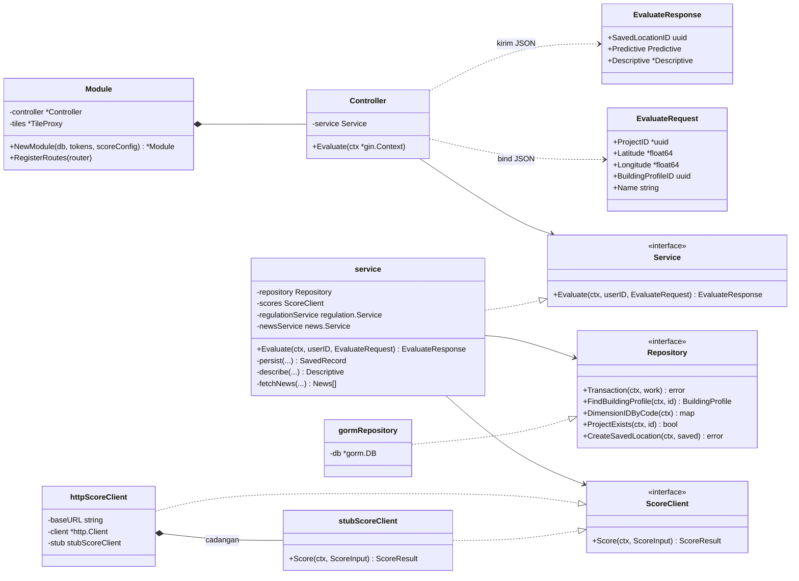
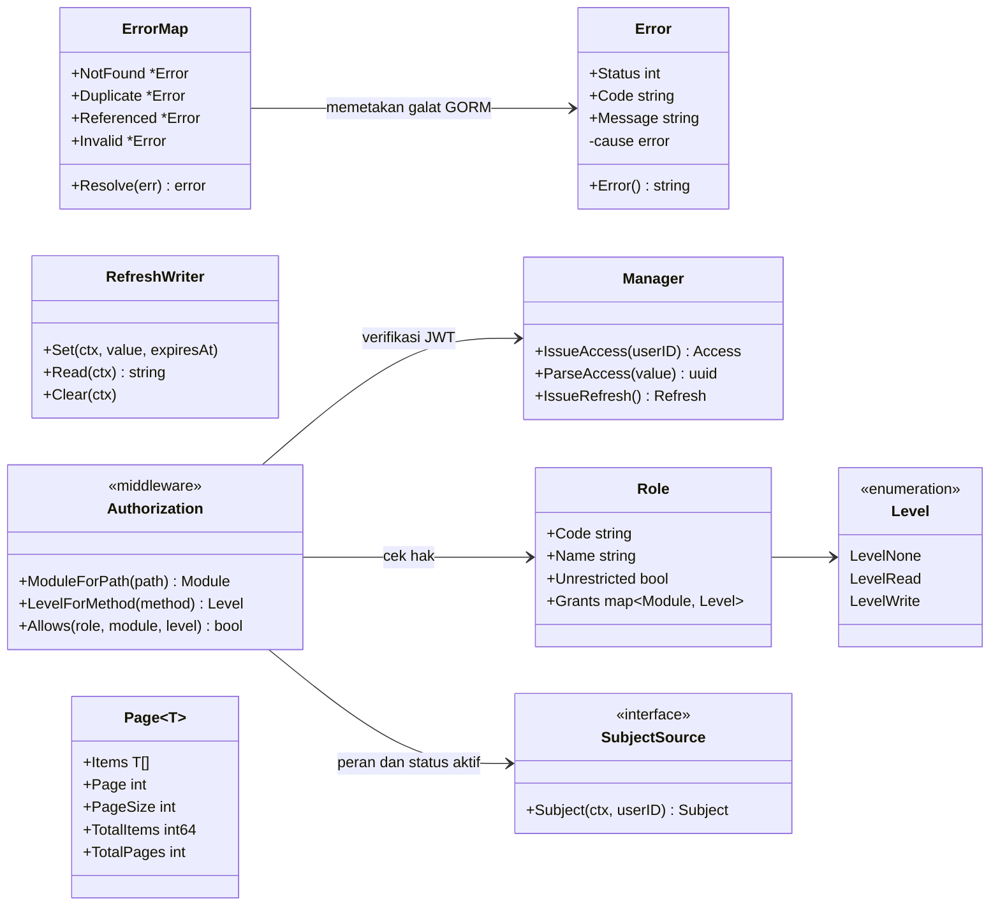
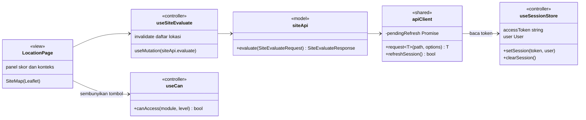
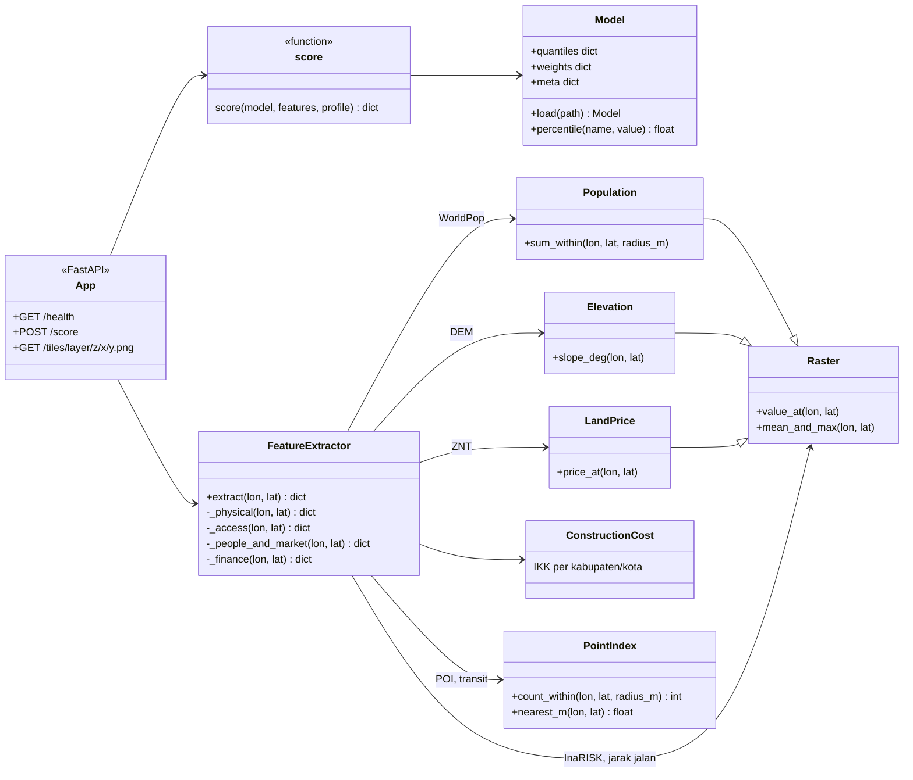

# Class Diagram

Go tidak punya kelas, tetapi `struct` dengan method dan `interface` berperan
sama, jadi digambar dengan notasi class diagram. Diagram di sini menunjukkan
**struktur kode**, bukan struktur data. Struktur data ada di [ERD](erd.md).

## 1. Pola vertical slice di backend

Setiap fitur backend adalah satu paket di `backend/internal/<slice>` dengan
lapisan yang sama. Contoh di bawah adalah slice `site` (evaluasi lokasi), karena
slice ini memakai semua lapisan sekaligus: repository, layanan luar, dan dua
slice lain.

| Lapisan | Tanggung jawab | Tidak boleh |
|---|---|---|
| `module.go` | Merakit dependensi dan mendaftarkan rute | Berisi logika bisnis |
| `controller.go` | Membaca request, validasi bentuk (`binding`), memanggil service, mengirim respons | Menyentuh database |
| `service.go` | Aturan bisnis: transisi status, perhitungan, transaksi | Tahu soal HTTP |
| `repository.go` | Query GORM dan SQL PostGIS | Membuat keputusan bisnis |
| `dto.go` | Bentuk JSON masuk dan keluar | Dipakai sebagai tabel |
| `entity.go` | Bentuk tabel dan migrasi | Dikirim langsung ke klien |

Karena `Service`, `Repository`, dan `ScoreClient` berupa interface, unit test
bisa mengganti implementasinya dengan versi palsu. Test repository memakai
driver SQL palsu (`shared/databasetest`) yang merekam query dan mengembalikan
hasil buatan, sehingga ke-70 berkas test Go berjalan tanpa database atau
layanan luar.

## 2. Infrastruktur bersama

Paket di `backend/internal/shared` dipakai semua slice.

| Paket | Isi |
|---|---|
| `apperror` | Satu tipe galat dengan status HTTP, kode mesin, dan pesan berbahasa Indonesia. Semua respons galat berbentuk sama |
| `database` | `ErrorMap` mengubah galat Postgres (data tidak ada, FK dilanggar, unik dilanggar) menjadi `apperror` milik slice |
| `token` | Menerbitkan dan memverifikasi JWT, membuat dan meng-hash refresh token |
| `cookie` | Menulis refresh token sebagai cookie `HttpOnly` |
| `access` | Matriks peran dan modul, satu sumber untuk backend dan nama modul di frontend |
| `middleware` | Autentikasi, otorisasi, CORS, dan pengubah galat menjadi JSON |
| `pagination` | Struktur halaman yang sama untuk semua daftar |

## 3. Frontend

Frontend memakai pembagian model, controller, dan view (lihat
`docs/requirements/frontend/arsitektur.md`). Contoh di bawah adalah alur evaluasi
lokasi dari halaman sampai request HTTP.

| Folder | Isi | Contoh |
|---|---|---|
| `src/models` | Tipe data dan fungsi pemanggil API (`*Api.ts`) | `salesApi.ts`, `onchainApi.ts` |
| `src/controllers` | Hook TanStack Query dan store sesi | `useSales.ts`, `sessionStore.ts`, `useAccess.ts` |
| `src/views` | Halaman dan komponen | `SalesPage.tsx`, `views/components/Data.tsx` |
| `src/shared` | Klien HTTP, format angka dan tanggal, pesan galat | `apiClient.ts`, `format.ts` |

## 4. Layanan penilaian (Python)

`FeatureExtractor` membaca bundle data GIS sekali saat layanan dinyalakan.
`Model` berisi kuantil tiap fitur (untuk mengubah angka mentah menjadi skor 0
sampai 100) dan bobot per profil hasil `train.py`. Bobot yang sama di-seed ke
tabel `weight` supaya terlihat di aplikasi.
