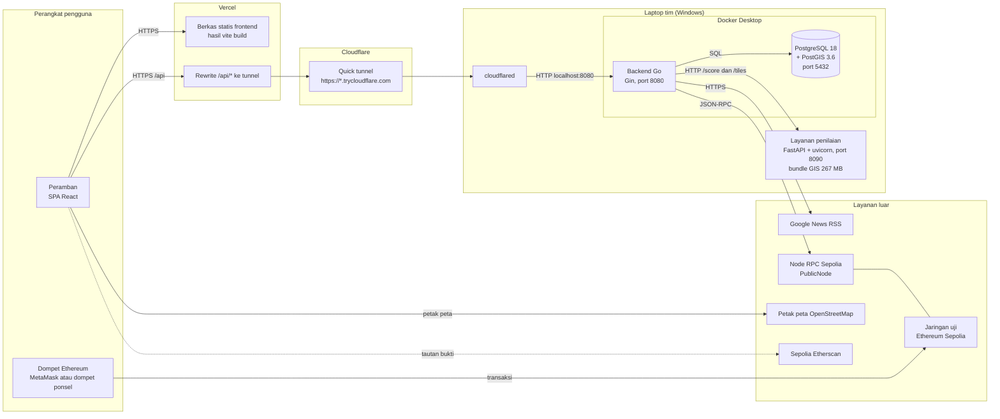
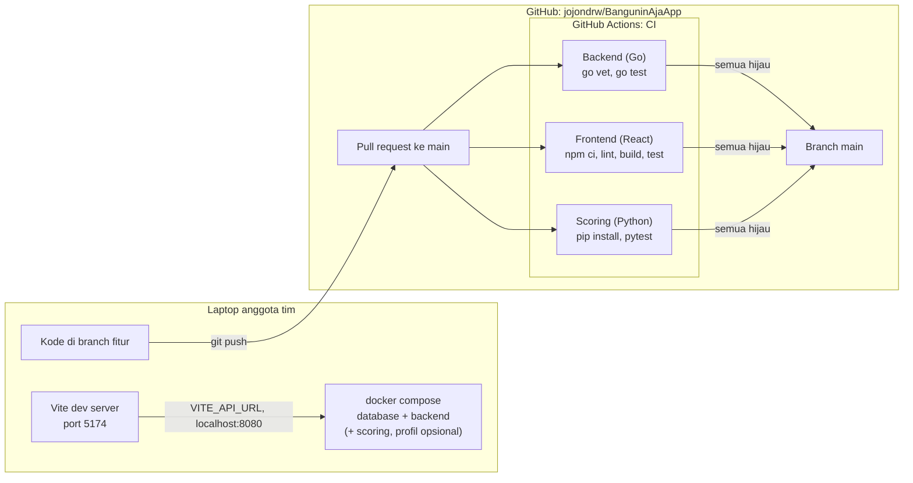
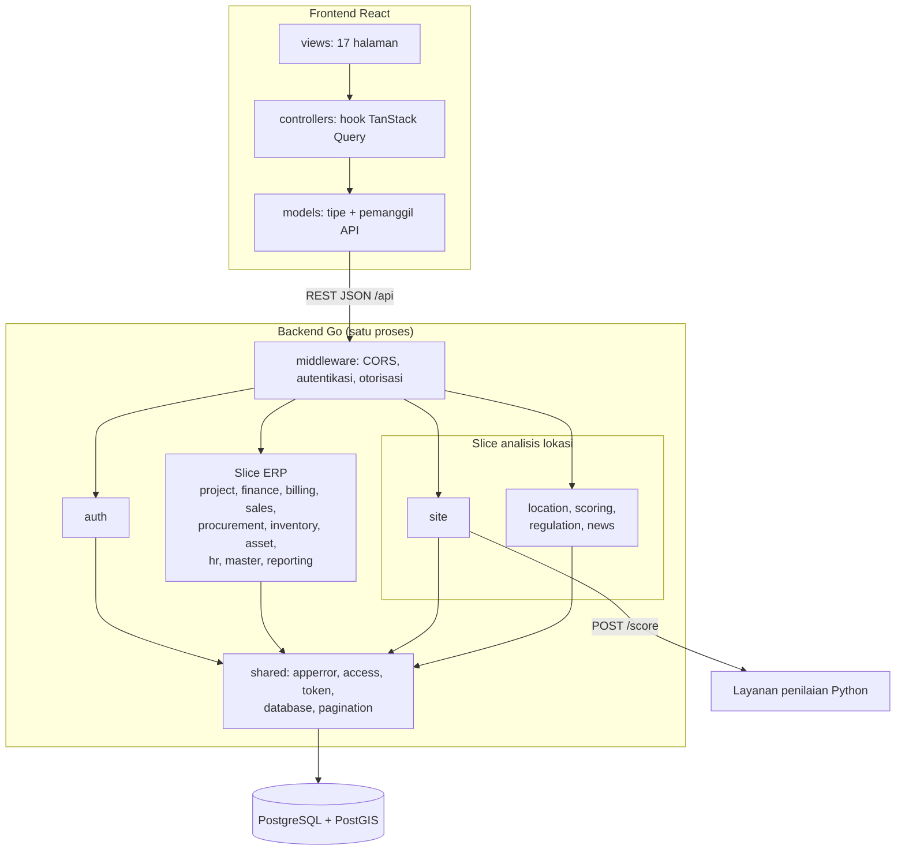

# Deployment dan Komponen

## 1. Demo online

Demo di <https://banguninaja.vercel.app> memakai backend yang berjalan di laptop
tim. Vercel hanya menyajikan berkas statis frontend dan meneruskan setiap
request `/api/*` ke laptop lewat Cloudflare quick tunnel, jadi tidak ada biaya
server. Konsekuensinya, demo hanya hidup selama laptop menyala.

| Node | Isi | Cara dinyalakan |
|---|---|---|
| Vercel | `frontend/dist` dan `vercel.json` berisi rewrite | `vercel deploy --prod` dari folder build |
| Cloudflare quick tunnel | Alamat publik acak ke `localhost:8080` | `cloudflared tunnel --url http://localhost:8080 --protocol http2` |
| Docker: `database` | Image `postgis/postgis:18-3.6`, volume `postgres_data` | `docker compose up -d` |
| Docker: `backend` | Go dengan hot reload `air` (`Dockerfile.dev`) | `docker compose up -d` |
| Layanan penilaian | Python 3 + FastAPI, membaca bundle data dari `BUNDLE_DIR` | `uvicorn banguninaja_scoring.app:app --port 8090` |

Langkah di atas dijalankan berurutan oleh satu skrip `start-online.ps1` di
laptop tim. Alamat quick tunnel berubah setiap kali dinyalakan, sehingga skrip
juga menulis ulang `vercel.json` dan mendeploy ulang frontend.

Yang hanya berjalan di peramban dan tidak melewati backend: petak peta
OpenStreetMap, dompet Ethereum, dan tautan ke Etherscan. Backend tidak pernah
memegang kunci privat dompet; ia hanya membaca transaksi lewat node RPC.

## 2. Pengembangan dan CI

Setiap perubahan masuk lewat branch dan pull request. Ketiga job CI berjalan
paralel di setiap PR, dan PR digabung ke `main` setelah ketiganya lulus. Branch
`main` belum diberi aturan proteksi di GitHub, jadi syarat ini masih berupa
kesepakatan tim, belum dipaksakan oleh GitHub.

## 3. Komponen

Backend adalah *modular monolith*: satu proses Go berisi 16 slice yang
dipisahkan per paket, berbagi satu database. Layanan penilaian dipisah ke
Python karena seluruh pengolahan raster dan vektor GIS tim sudah ditulis dengan
pustaka Python (rasterio, geopandas).

| Keputusan | Alasan |
|---|---|
| Modular monolith, bukan microservice | Tim lima orang dan satu database; batas antar-slice cukup dijaga dengan paket Go, tanpa biaya jaringan dan deployment banyak layanan |
| Satu layanan Python terpisah | Kode GIS tim sudah dalam Python; menulis ulang zonal statistics di Go tidak memberi manfaat |
| PostGIS | Pencarian regulasi terdekat (`ST_DWithin`) dan penyimpanan titik lokasi dilakukan di database |
| Frontend statis di Vercel | Gratis, HTTPS otomatis, dan frontend tidak butuh server sendiri |

## 4. Keterbatasan deployment saat ini

| Keterbatasan | Dampak | Rencana jika dilanjutkan |
|---|---|---|
| Backend di laptop | Demo mati kalau laptop mati, tidur, atau disknya penuh | Pindah ke VPS atau layanan kontainer |
| Alamat tunnel berubah | Setiap restart harus deploy ulang frontend | Named tunnel Cloudflare dengan domain tetap |
| Satu instans, tanpa replikasi | Tidak ada ketersediaan tinggi | Database terkelola dengan replika |
| Belum ada backup database terjadwal | Data demo hilang kalau volume Docker rusak | `pg_dump` terjadwal ke penyimpanan terpisah |
| Bundle GIS di Google Drive | Anggota baru harus mengunduh manual | Penyimpanan objek dengan akses terbatas |
