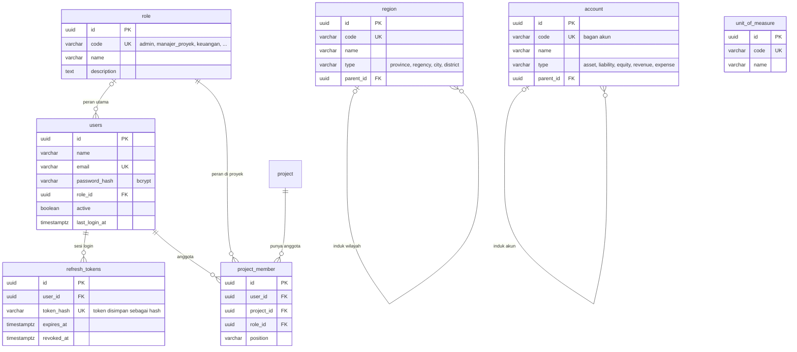
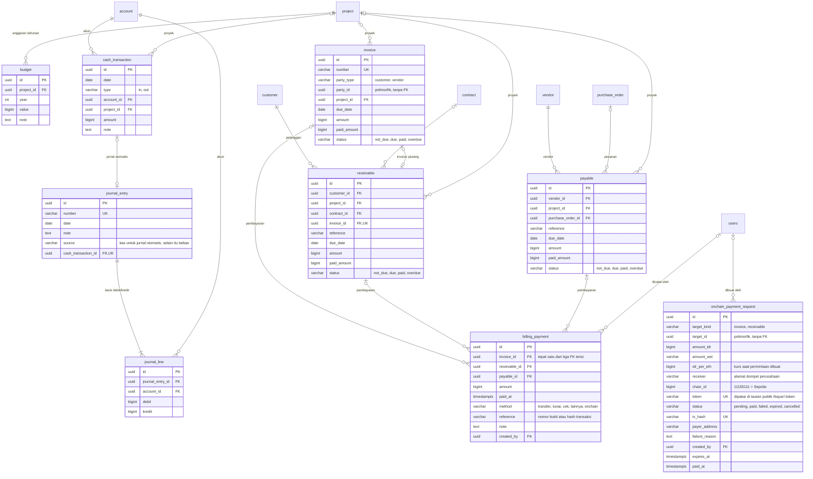
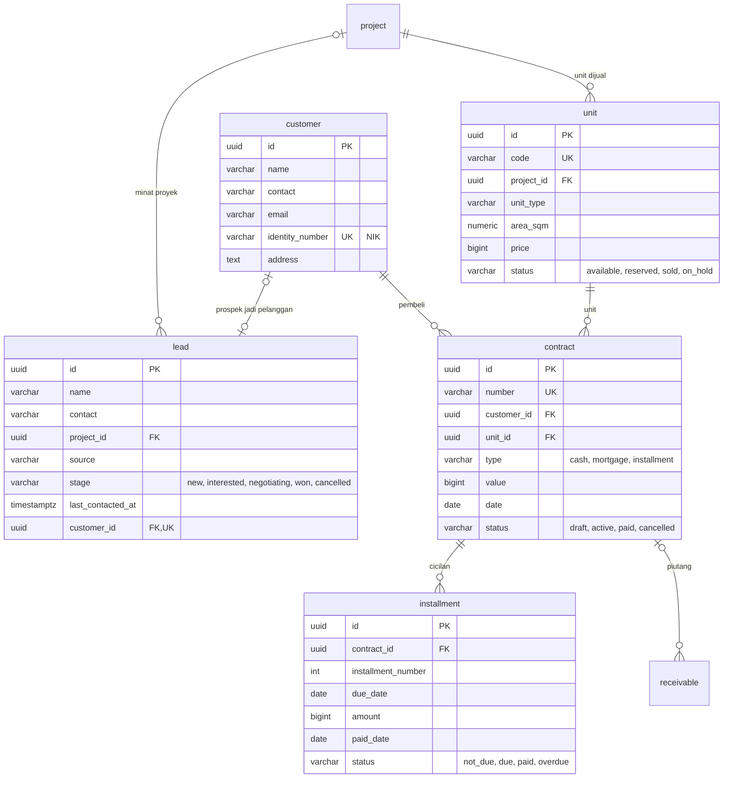
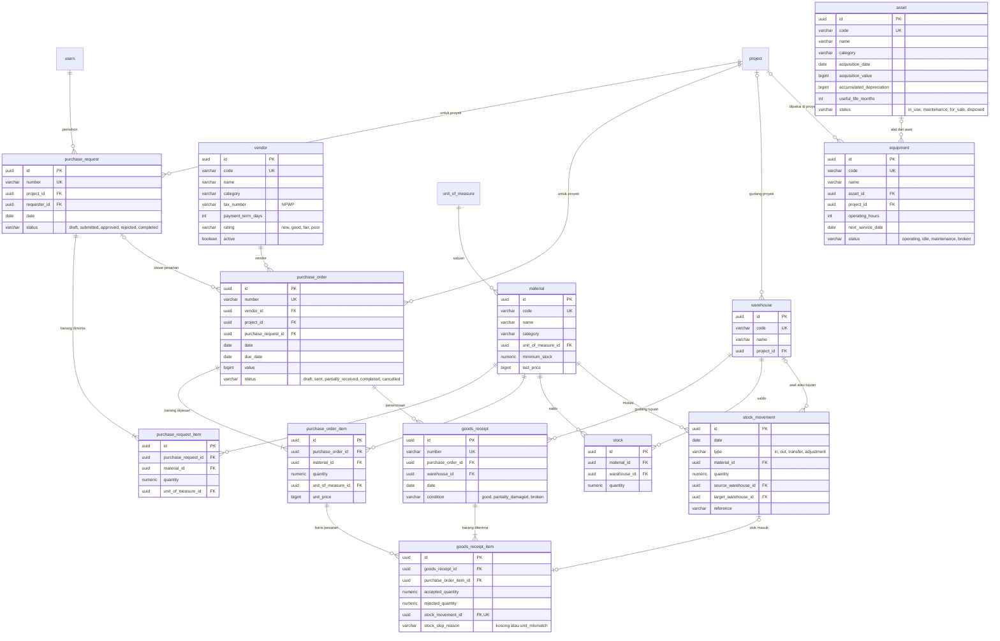
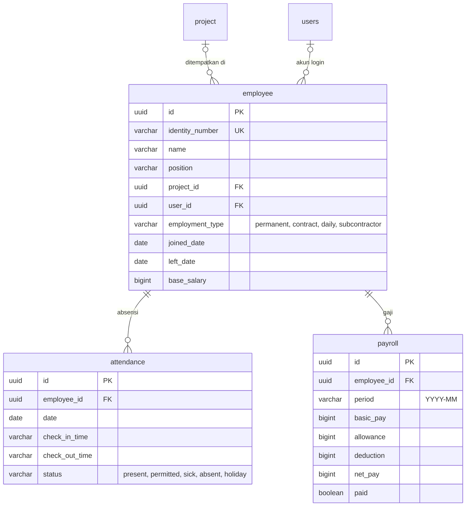
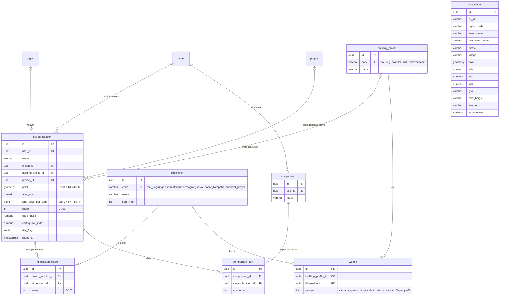

# ERD (Entity Relationship Diagram)

Diturunkan dari skema database yang berjalan (PostgreSQL 18 + PostGIS), bukan
dari rancangan awal. Daftar foreign key diambil langsung dari `pg_constraint`,
jadi setiap garis di bawah ada di database sungguhan.

| | Jumlah |
|---|---|
| Tabel aplikasi | 55 (ditambah `spatial_ref_sys` milik PostGIS) |
| Foreign key | 91 |
| Slice backend yang memiliki tabel | 14 |

Satu diagram berisi 55 tabel tidak terbaca, jadi ERD dipecah per domain. Tabel
dari domain lain hanya ditampilkan namanya supaya garis relasinya tetap kelihatan.

## Cara membaca

| Notasi | Arti |
|---|---|
| `PK` | Kunci utama. Semua tabel memakai UUID v4 yang dibuat aplikasi |
| `FK` | Foreign key |
| `UK` | Unik |
| `\|\|--o{` | Satu ke banyak, sisi kiri wajib ada |
| `\|o--o{` | Satu ke banyak, kolom FK boleh kosong |
| `\|o--o\|` | Satu ke satu, FK boleh kosong dan unik |

Kolom `created_at` dan `updated_at` ada di semua tabel dan tidak ditulis ulang.
Uang disimpan sebagai `bigint` rupiah penuh, kuantitas barang sebagai `numeric`.

## 1. Akses dan data master

Peran utama pengguna ada di `users.role_id`. Peran per proyek ada di
`project_member`, sehingga satu orang bisa menjadi manajer di satu proyek dan
pengamat di proyek lain.

## 2. Proyek

```mermaid
erDiagram
    region |o--o{ project : "lokasi"
    project ||--o{ project_phase : "tahap"
    project ||--o{ budget_item : "RAB"
    project_phase |o--o{ budget_item : "bobot tahap"
    unit_of_measure ||--o{ budget_item : "satuan"
    project ||--o{ project_progress : "riwayat progres"
    project ||--o{ daily_report : "laporan harian"
    users |o--o{ daily_report : "dibuat oleh"
    project ||--o| construction_contract : "kontrak kontraktor"
    vendor ||--o{ construction_contract : "kontraktor"
    project ||--o{ payment_term : "termin"
    payable |o--o| payment_term : "hutang termin"
    users |o--o{ payment_term : "diajukan oleh"
    project ||--o{ contract_change : "adendum"
    users |o--o{ contract_change : "diusulkan atau diputuskan oleh"
    project ||--o{ permit : "izin"
    project ||--o{ project_member : "anggota"
    project |o--o{ report : "laporan"
    users ||--o{ report : "dibuat oleh"

    project {
        uuid id PK
        varchar code UK
        varchar name
        uuid region_id FK
        varchar type "teks bebas, mis. Perumahan, Ruko"
        varchar status "planning, ongoing, on_hold, completed, cancelled"
        int progress "rata-rata berbobot nilai RAB per tahap"
        date start_date
        date target_end_date
        bigint contract_value
    }
    project_phase {
        uuid id PK
        uuid project_id FK
        varchar name
        int sort_order
        date start_date
        date target_end_date
        int progress
        varchar status
    }
    budget_item {
        uuid id PK
        uuid project_id FK
        uuid phase_id FK "boleh kosong"
        varchar code
        varchar description
        numeric volume
        uuid unit_of_measure_id FK
        bigint unit_price
        bigint total "volume x harga satuan, dihitung server"
    }
    project_progress {
        uuid id PK
        uuid project_id FK
        date recorded_on "unik per proyek"
        int progress
    }
    daily_report {
        uuid id PK
        uuid project_id FK
        date report_date "unik per proyek"
        varchar weather_morning
        varchar weather_afternoon
        int workers
        varchar equipment
        text work_done
        text issues
        uuid created_by FK
    }
    construction_contract {
        uuid id PK
        uuid project_id FK "UK, satu per proyek"
        uuid vendor_id FK
        varchar number "nomor SPK"
        bigint value
        numeric retention_percent "0 sampai 10"
    }
    payment_term {
        uuid id PK
        uuid project_id FK
        varchar kind "progress, retention"
        int required_progress
        numeric percent "persen nilai kontrak"
        bigint gross_amount
        bigint retention_amount
        uuid payable_id FK "UK"
        date claimed_on
        int claimed_progress
        uuid claimed_by FK
    }
    contract_change {
        uuid id PK
        uuid project_id FK
        int sequence "unik per proyek"
        varchar description
        bigint value_change "negatif untuk pekerjaan kurang"
        int days_change
        varchar status "proposed, approved, rejected"
        uuid proposed_by FK
        uuid decided_by FK
        date decided_on
    }
    permit {
        uuid id PK
        uuid project_id FK
        varchar type "teks bebas, mis. PKKPR, PBG, SLF"
        varchar number
        date issued_date
        date valid_until
        varchar status "submitted, issued, expired, rejected"
    }
    report {
        uuid id PK
        varchar name
        varchar type
        varchar scope
        uuid project_id FK
        date period_start
        date period_end
        varchar format "pdf, xlsx, csv"
        uuid created_by FK
    }
```

## 3. Keuangan dan tagihan

Buku besar (`journal_entry`, `journal_line`) tidak terikat proyek, sedangkan
anggaran dan transaksi kas terikat proyek. `invoice.party_id` bisa menunjuk
pelanggan atau vendor (dibedakan `party_type`), dan
`onchain_payment_request.target_id` bisa menunjuk invoice atau piutang
(dibedakan `target_kind`). Karena polimorfik, keduanya tidak punya foreign key
di database dan dijaga oleh service.

## 4. Penjualan

Membuat kontrak mengubah unit dari `available` menjadi `reserved`. Kontrak
`paid` membuat unit `sold`, kontrak `cancelled` mengembalikan unit ke
`available`. Satu prospek (`lead`) paling banyak menjadi satu pelanggan.

## 5. Pengadaan, inventaris, dan aset

Setiap baris penerimaan barang yang diterima mencatat `stock_movement` masuk ke
gudang tujuan. Kalau satuan barang di pesanan berbeda dengan satuan material,
pencatatan stok dilewati dan alasannya disimpan di `stock_skip_reason`.

## 6. SDM

## 7. Analisis lokasi

`regulation` tidak punya foreign key. Tabel ini dicocokkan dengan titik lokasi
secara spasial (`ST_DWithin` pada kolom `point`), bukan lewat kunci. Baris
dengan `is_simulated = true` adalah data simulasi untuk wilayah yang belum punya
data RDTR asli.

