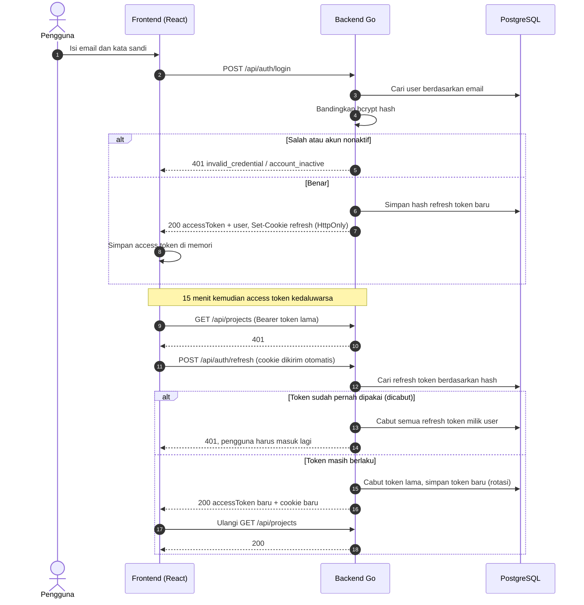
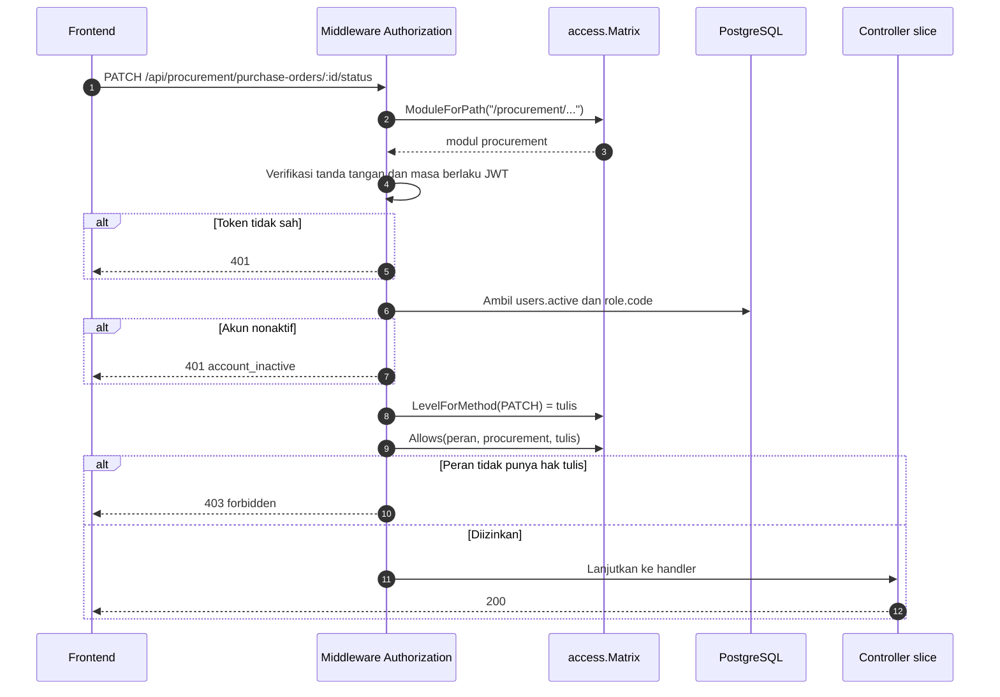
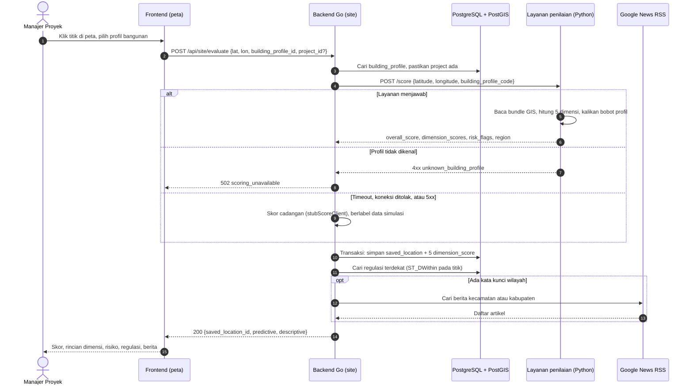
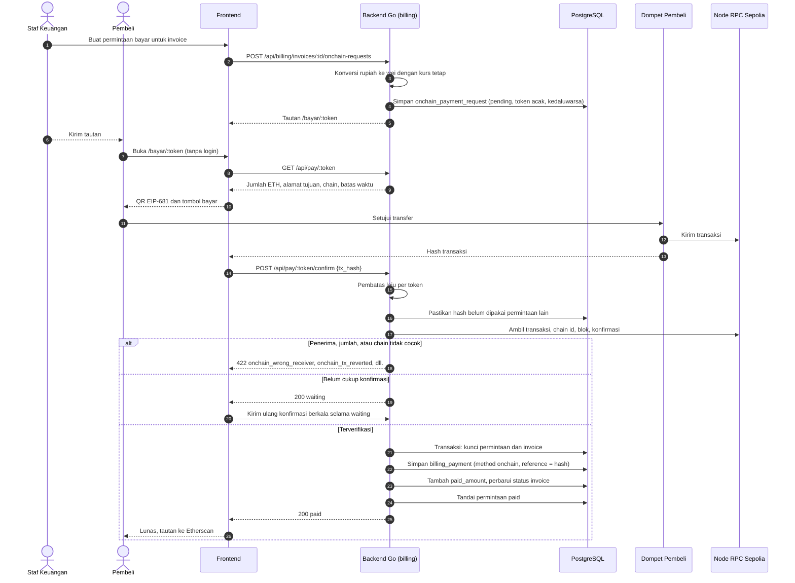
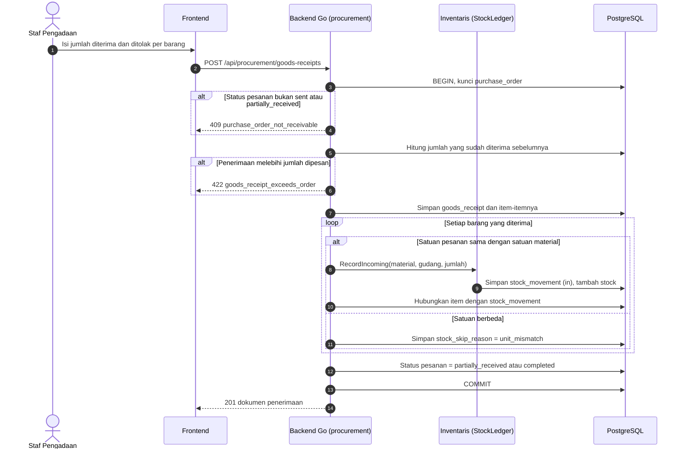

# Sequence Diagram

Lima alur yang paling menentukan perilaku sistem. Nama endpoint, fungsi, dan
kode galat di diagram sama dengan yang ada di kode, sehingga diagram ini bisa
dipakai untuk menelusuri kode.

| No | Alur | Kode utama |
|---|---|---|
| 1 | Masuk dan memperbarui sesi | `auth/service.go`, `shared/cookie`, `frontend/src/shared/apiClient.ts` |
| 2 | Pemeriksaan hak akses setiap request | `shared/middleware/authorization.go`, `shared/access/matrix.go` |
| 3 | Evaluasi lokasi | `site/service.go`, `scoring/banguninaja_scoring` |
| 4 | Pembayaran on-chain | `billing/onchain.go`, `billing/onchain_verify.go`, `views/pay` |
| 5 | Penerimaan barang | `procurement/service.go` (`receiveGoods`) |

## 1. Masuk dan memperbarui sesi

Access token (JWT, 15 menit) hanya disimpan di memori frontend (store Zustand
tanpa `persist`), tidak di `localStorage`, sehingga tidak tertinggal di peramban.
Saat halaman dimuat ulang, sesi dipulihkan lewat `/auth/refresh`. Refresh token (7 hari)
dikirim sebagai cookie `HttpOnly` dan hanya hash SHA-256-nya yang disimpan di
database.

Kalau beberapa request gagal 401 bersamaan, frontend hanya mengirim satu
`/auth/refresh` (`pendingRefresh` di `apiClient.ts`) dan semua request menunggu
hasil yang sama. Tanpa ini, rotasi token akan menganggap request kedua sebagai
pemakaian ulang dan mengeluarkan pengguna.

## 2. Pemeriksaan hak akses setiap request

Hak akses tidak dibaca dari isi JWT. Peran dan status aktif diambil dari
database di setiap request, jadi perubahan peran atau penonaktifan oleh Admin
langsung berlaku tanpa menunggu token kedaluwarsa.

## 3. Evaluasi lokasi

Skor prediktif dan konteks deskriptif sengaja dipisah. Kalau regulasi atau
berita gagal diambil, evaluasi tetap berhasil dan bagian itu kosong.

Kalau layanan penilaian tidak bisa dihubungi (timeout, koneksi ditolak, galat
5xx), backend tidak gagal tetapi memakai **skor cadangan** dari
`stubScoreClient`: nilai semu 55 sampai 95 yang diturunkan dari hash koordinat,
dengan penjelasan berlabel "data simulasi". Galat `scoring_unavailable` (502)
hanya muncul kalau profil bangunan tidak dikenal.

## 4. Pembayaran on-chain

Pembeli membayar ke alamat dompet perusahaan di jaringan uji Ethereum Sepolia,
lalu backend memverifikasi transaksinya sendiri lewat node RPC. Backend tidak
pernah memegang kunci privat; ia hanya membaca blockchain.

Pemeriksaan yang mencegah pembayaran palsu atau ganda:

| Pemeriksaan | Mencegah |
|---|---|
| `tx_hash` unik di seluruh permintaan | Satu transaksi dipakai melunasi dua tagihan |
| Penerima dan nilai harus sama dengan permintaan | Transfer ke alamat lain atau kurang bayar dianggap lunas |
| Chain id node harus 11155111 | Transaksi dari jaringan lain |
| Blok transaksi harus sebelum `expires_at` | Membayar dengan kurs yang sudah kedaluwarsa |
| Baris permintaan dikunci (`SELECT ... FOR UPDATE`) | Dua konfirmasi bersamaan mencatat pembayaran dua kali |

## 5. Penerimaan barang

Penerimaan barang mengubah tiga hal sekaligus dalam satu transaksi database:
dokumen penerimaan, stok gudang, dan status pesanan.

