# State Diagram dan Activity Diagram

State diagram menggambarkan siklus hidup satu dokumen. Setiap panah adalah
transisi yang diizinkan service backend; transisi lain ditolak dengan galat
409 atau 422, sehingga data tidak bisa melompati tahap. Activity diagram
menggambarkan pekerjaan nyata pengguna yang melintasi beberapa modul.

Sumber aturan transisi:

| Dokumen | Kode |
|---|---|
| Proyek | `projectTransitions` di `project/service.go` |
| Tahap proyek | `phaseStatus` di `project/service.go` |
| Termin kontraktor | `newPaymentScheduleResponse`, `claimBlocker`, `releasableRetention` di `project/payment_term.go` |
| Adendum kontrak | `DecideContractChange` di `project/contract_change.go` |
| Permintaan dan pesanan pembelian | `requestTransitions`, `orderTransitions`, `statusAfterReceipt` di `procurement/service.go` |
| Kontrak dan unit | `contractTransitions`, `unitStatusAfterContract` di `sales/service.go` |
| Jatuh tempo tagihan dan cicilan | `duedate.Status` di `shared/duedate` |
| Permintaan bayar on-chain | `billing/onchain.go` |

## State diagram

### Proyek

Proyek `completed` atau `cancelled` tidak bisa diubah lagi (`project_closed`).

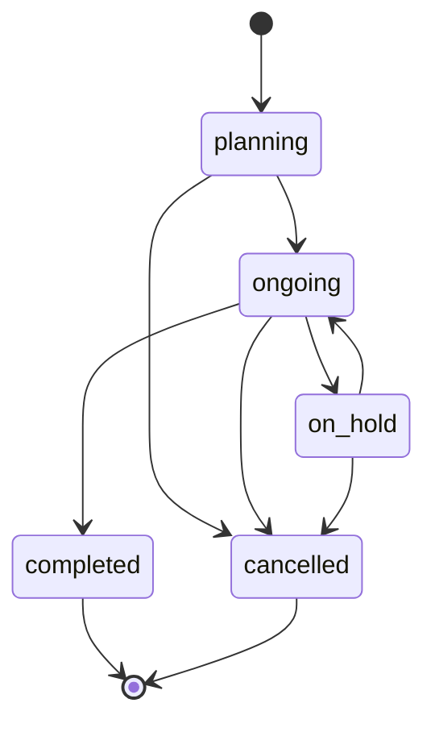

### Tahap proyek

Status tahap tidak dipilih pengguna. Status diturunkan dari progres yang diisi.
Progres proyek adalah rata-rata progres tahap yang dibobot nilai RAB tiap tahap,
atau bobot sama kalau belum ada item RAB yang ditautkan ke tahap.

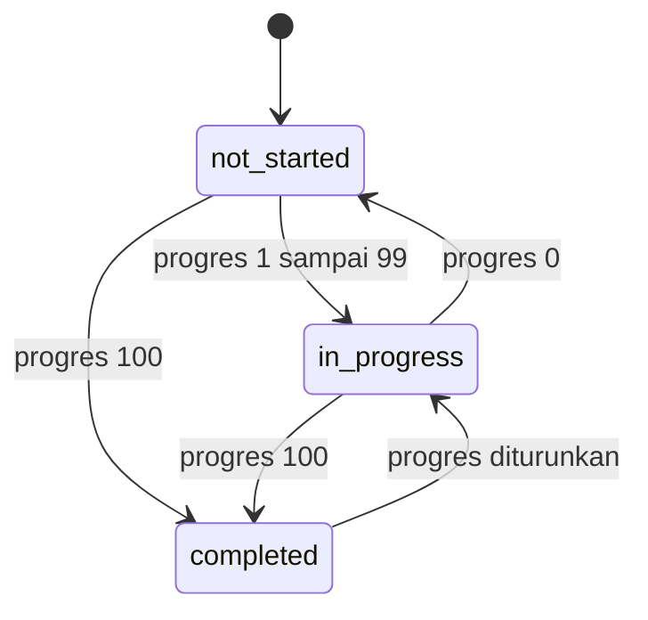

### Termin kontraktor

Status termin tidak disimpan sebagai kolom. Status dihitung dari progres
berbobot proyek dan dari hutang yang tertaut di modul Tagihan, jadi selalu
sesuai keadaan terakhir.

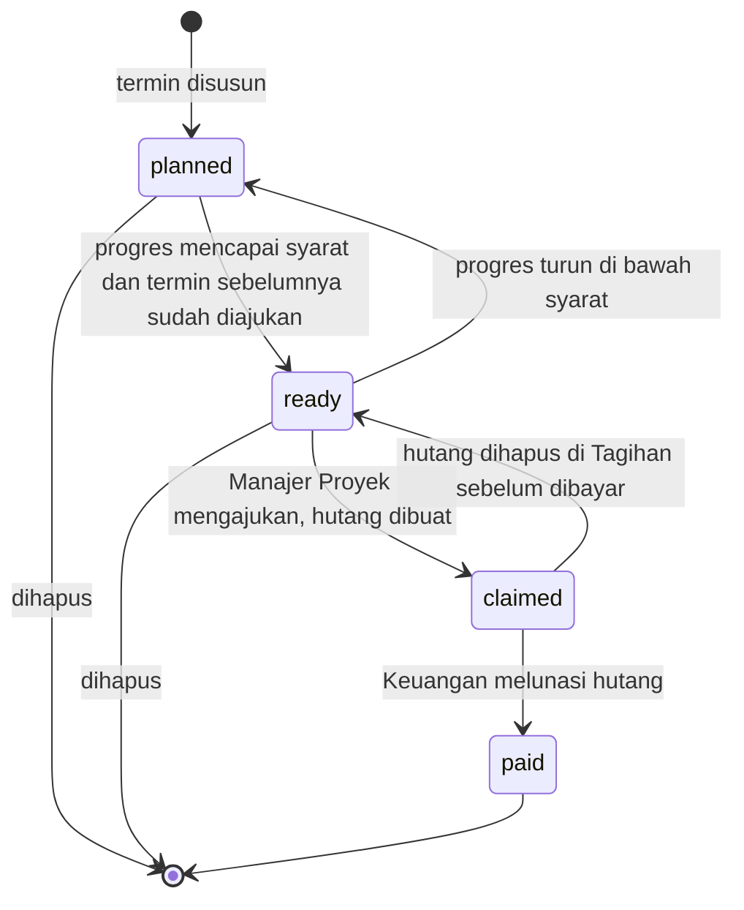

### Adendum kontrak kontraktor

Manajer Proyek mengusulkan, hanya Admin yang memutuskan, dan keputusan bersifat
final. Hanya adendum yang disetujui yang mengubah nilai kontrak berjalan.

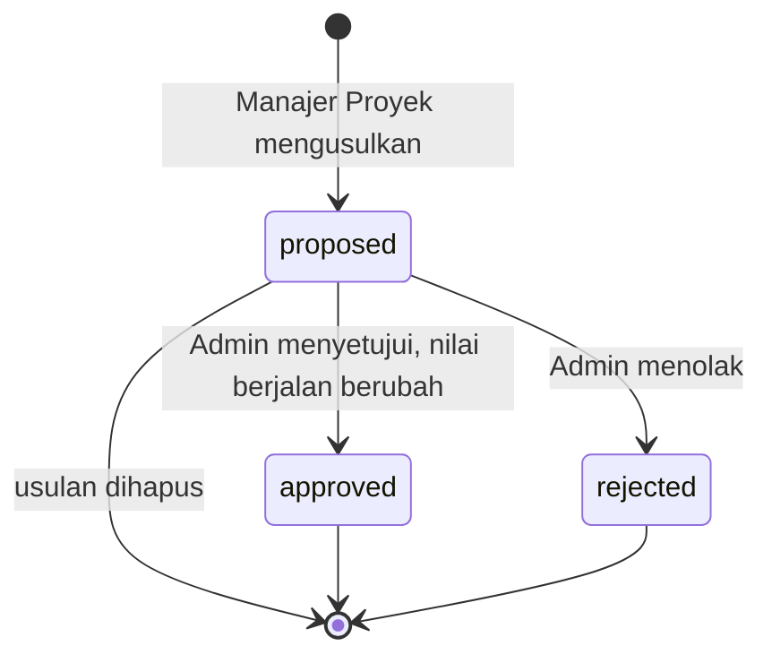

### Permintaan pembelian dan pesanan pembelian

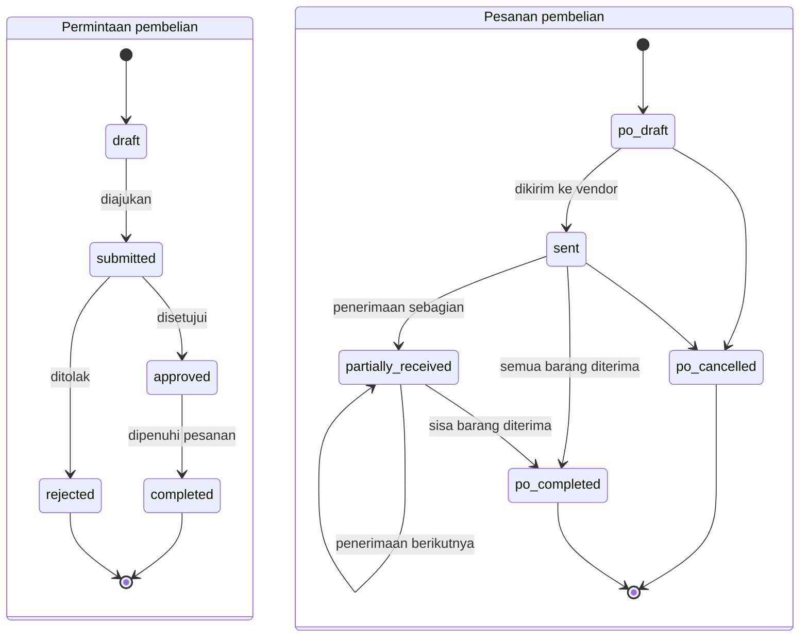

Status pesanan `po_draft`, `po_cancelled`, dan `po_completed` di diagram adalah
`draft`, `cancelled`, dan `completed` di database; awalan hanya untuk membedakan
dari status permintaan. Perpindahan ke `partially_received` dan `completed`
hanya terjadi lewat pencatatan penerimaan barang, tidak bisa dipilih manual.

### Kontrak penjualan dan unit

Kontrak dan unit berubah bersama. Unit hanya bisa dipakai satu kontrak yang
masih berjalan, dan kontrak hanya bisa `paid` kalau semua cicilannya lunas
(`contract_unpaid`).

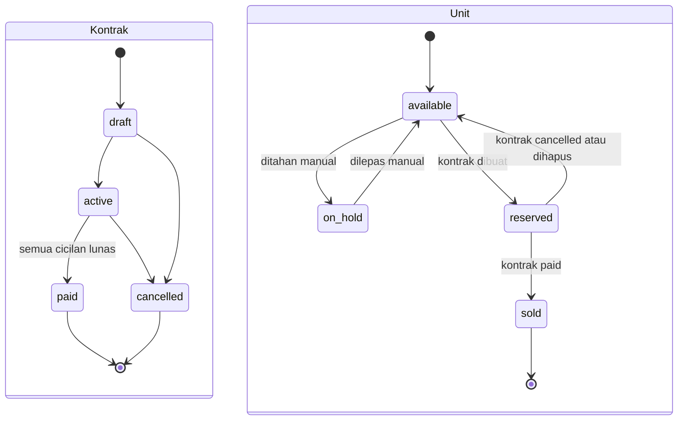

### Jatuh tempo invoice, piutang, hutang, dan cicilan

Status ini dihitung dari tanggal jatuh tempo dan tanggal hari ini setiap kali
data dibaca, jadi tidak pernah basi.

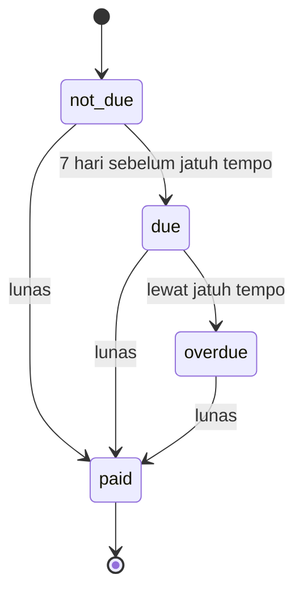

### Permintaan bayar on-chain

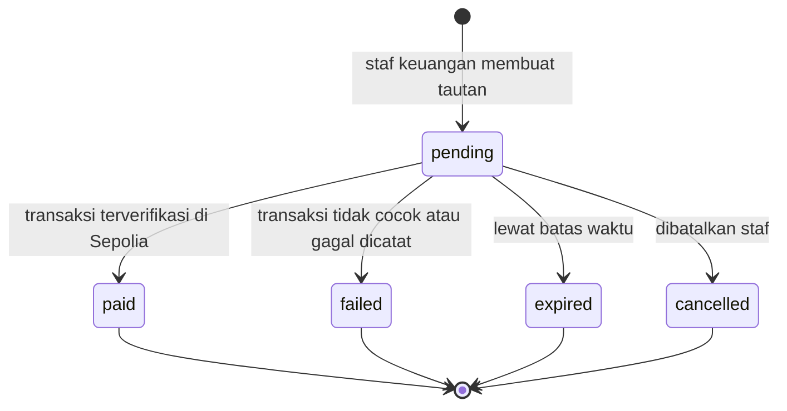

Status `expired` juga ditampilkan tanpa menunggu baris diperbarui: permintaan
`pending` yang sudah lewat `expires_at` langsung dianggap `expired` saat dibaca
(`effectiveStatus`).

## Activity diagram

### Memilih lokasi proyek

Proses bisnis inti produk: dari beberapa titik kandidat sampai satu lokasi
dipilih untuk proyek.

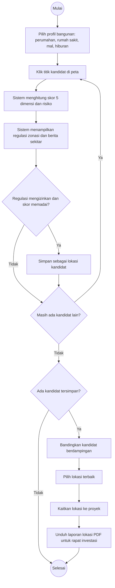

### Pengadaan material sampai pembayaran vendor

Melintasi dua peran dan empat modul. Manajer Proyek hanya punya hak baca di
modul Pengadaan, jadi permintaan pembelian dibuat dan disetujui oleh peran
Pengadaan (atau Admin).

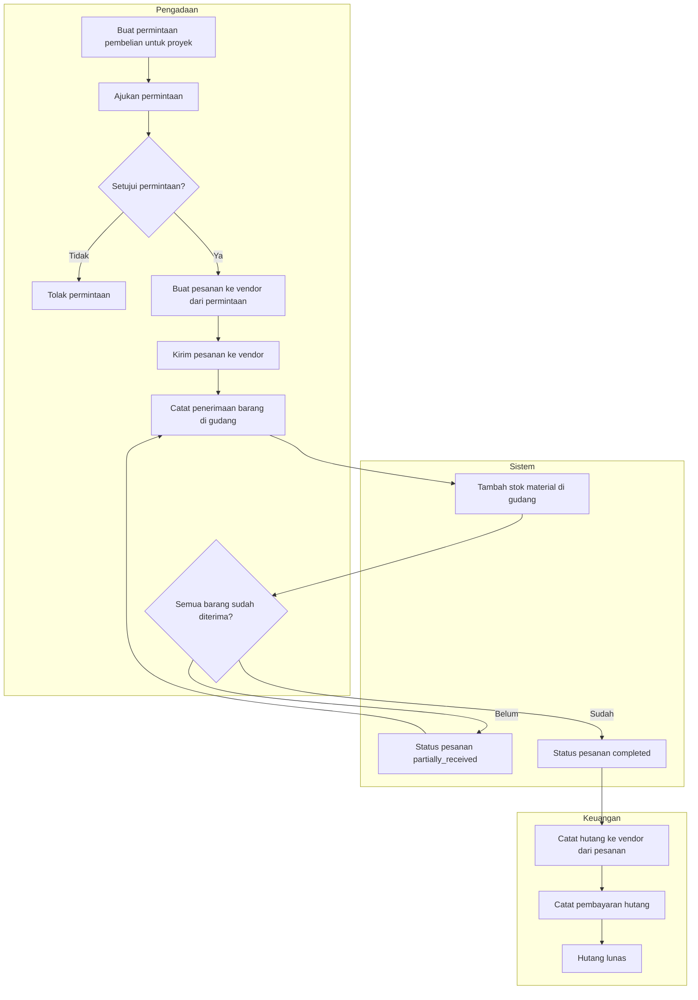

### Pembayaran kontraktor per termin sampai retensi

Manajer Proyek mengesahkan progres dengan mengajukan termin, Keuangan yang
membayar. Keduanya tidak bisa saling menggantikan karena hak aksesnya berbeda:
pengajuan butuh hak tulis Proyek, pembayaran butuh hak tulis Tagihan.

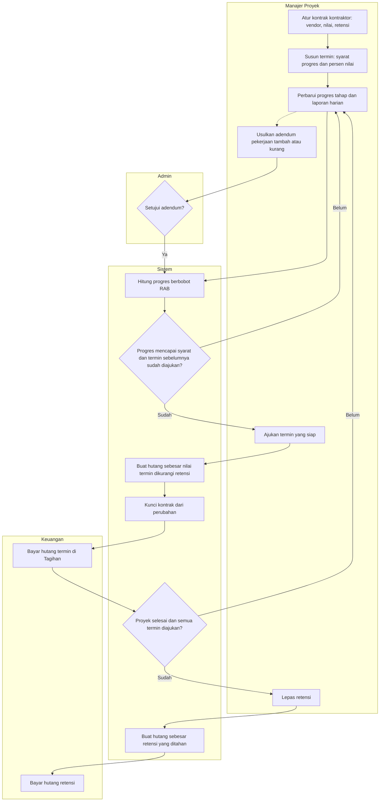

### Penjualan unit sampai lunas

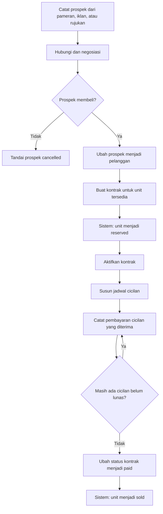

Pembayaran on-chain tersedia untuk invoice dan piutang di modul Tagihan, tetapi
belum terhubung ke cicilan di modul Penjualan. Kalau pembeli membayar piutang
kontrak secara on-chain, cicilan yang bersangkutan masih perlu ditandai lunas di
modul Penjualan.
