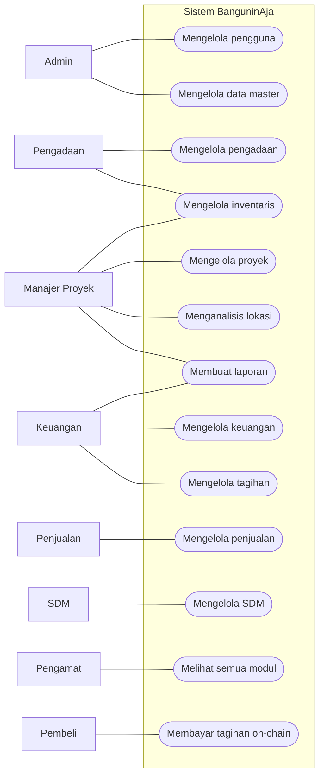
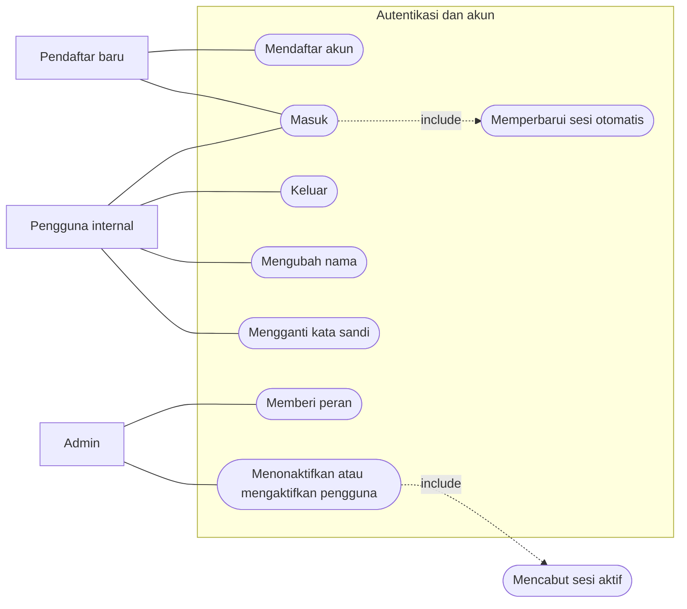
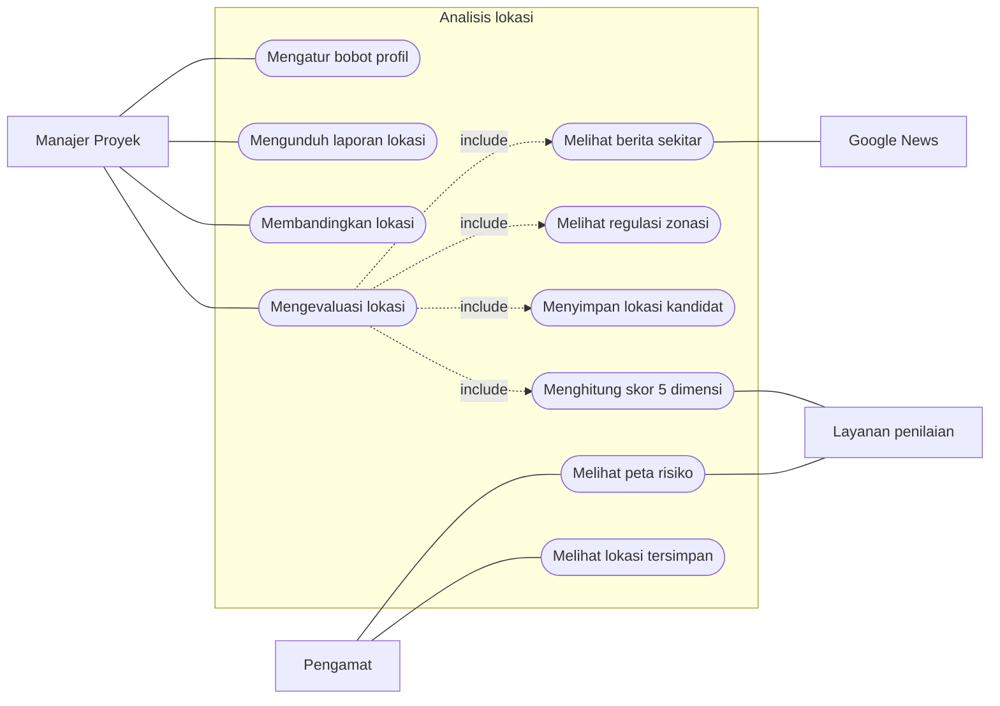
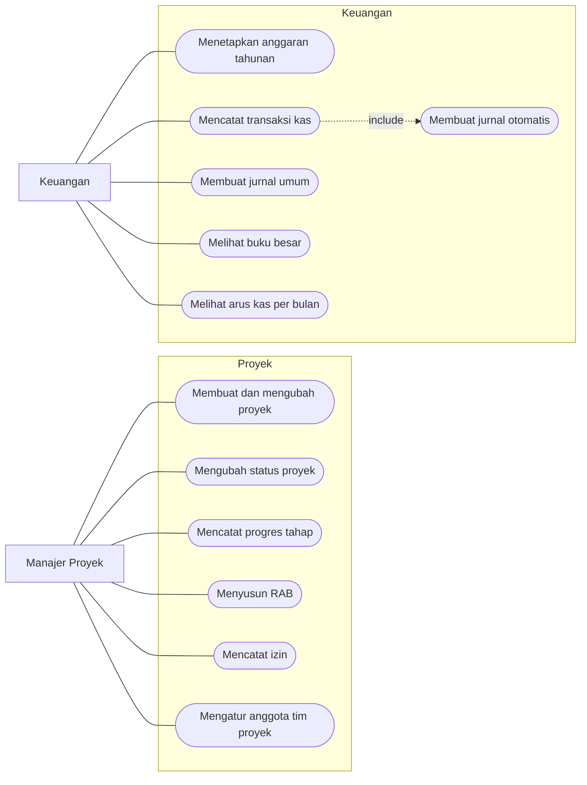
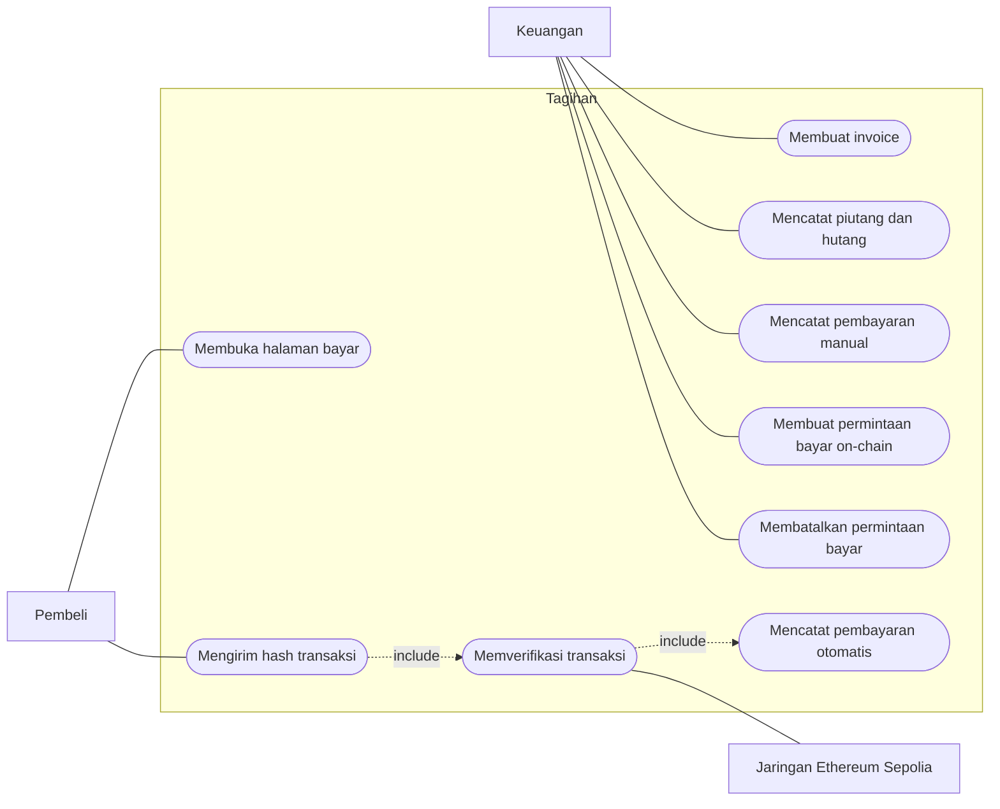
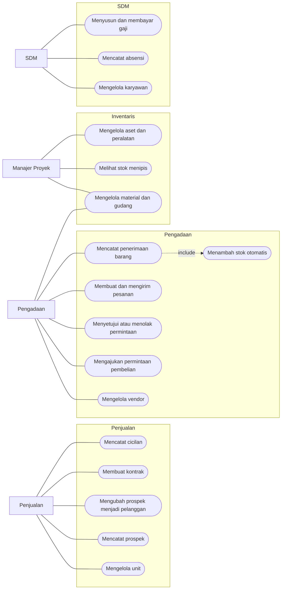

# Use Case

Aktor dan use case di bawah diturunkan dari kode: peran dan haknya dari
`backend/internal/shared/access/matrix.go`, use case dari rute API di setiap
`module.go` (224 endpoint) dan halaman di `frontend/src/views`.

## Aktor

| Aktor | Jenis | Keterangan |
|---|---|---|
| Admin | Pengguna internal | Semua modul, termasuk kelola pengguna. Pengguna pertama yang mendaftar otomatis menjadi Admin |
| Manajer Proyek | Pengguna internal | Proyek, analisis lokasi, inventaris; melihat pengadaan dan keuangan |
| Keuangan | Pengguna internal | Keuangan dan tagihan; melihat proyek, penjualan, pengadaan |
| Pengadaan | Pengguna internal | Pengadaan dan inventaris |
| Penjualan | Pengguna internal | Penjualan; melihat proyek dan tagihan |
| SDM | Pengguna internal | Karyawan, absensi, penggajian |
| Pengamat | Pengguna internal | Melihat semua modul tanpa mengubah data, kecuali kelola pengguna |
| Pendaftar baru | Calon pengguna | Sudah punya akun tapi belum diberi peran, jadi belum bisa membuka modul apa pun |
| Pembeli | Pihak luar | Membayar tagihan lewat tautan publik `/bayar/:token` tanpa akun |
| Layanan penilaian | Sistem | Layanan Python yang menghitung skor lokasi (`POST /score`) |
| Google News | Sistem | Sumber berita sekitar lokasi (RSS) |
| Jaringan Ethereum Sepolia | Sistem | Tempat transaksi pembayaran on-chain diverifikasi lewat node RPC |

## Hak akses per peran

`T` = baca dan ubah, `B` = baca saja, `-` = tidak bisa membuka. Hak ini dijaga di
backend oleh middleware akses, dan di frontend tombol ubah disembunyikan untuk
peran yang hanya bisa membaca.

| Modul | Admin | Manajer Proyek | Keuangan | Pengadaan | Penjualan | SDM | Pengamat |
|---|---|---|---|---|---|---|---|
| Proyek | T | T | B | B | B | B | B |
| Analisis Lokasi | T | T | - | - | - | - | B |
| Keuangan | T | B | T | - | - | - | B |
| Tagihan | T | - | T | - | B | - | B |
| Penjualan | T | - | B | - | T | - | B |
| Pengadaan | T | B | B | T | - | - | B |
| Inventaris | T | T | - | T | - | - | B |
| SDM | T | - | - | - | - | T | B |
| Data Master | T | B | B | B | B | B | B |
| Laporan | T | T | T | B | B | B | B |
| Pengguna | T | - | - | - | - | - | - |

## Gambaran umum

Use case dikelompokkan per modul. Garis dari aktor ke modul berarti aktor itu
bisa mengubah data di modul tersebut; akses baca saja ada di tabel di atas.

Admin juga terhubung ke semua use case lain; garisnya tidak digambar supaya
diagram tetap terbaca.

## Autentikasi dan akun

Aturan yang terlihat di use case ini:

- Backend menolak perubahan peran atau status yang membuat tidak ada lagi Admin
  aktif (`last_admin`). Tombol Nonaktifkan juga tidak ditampilkan di baris akun
  sendiri.
- Menonaktifkan pengguna mencabut semua refresh token-nya, jadi sesi yang sedang
  terbuka tidak bisa diperpanjang lagi.

## Analisis lokasi

Use case inti produk: menilai kelayakan satu titik untuk satu profil bangunan.

Regulasi dan berita ditampilkan sebagai konteks dan **tidak ikut dihitung** dalam
skor. Regulasi adalah syarat sah atau tidak, sehingga tidak boleh dikompensasi
oleh skor pasar yang tinggi.

## Proyek dan keuangan

Progres proyek dihitung server dari rata-rata progres tahap, dan total RAB dari
volume kali harga satuan. Pengguna tidak mengisi angka turunan ini sendiri.

## Tagihan dan pembayaran on-chain

## Operasional

