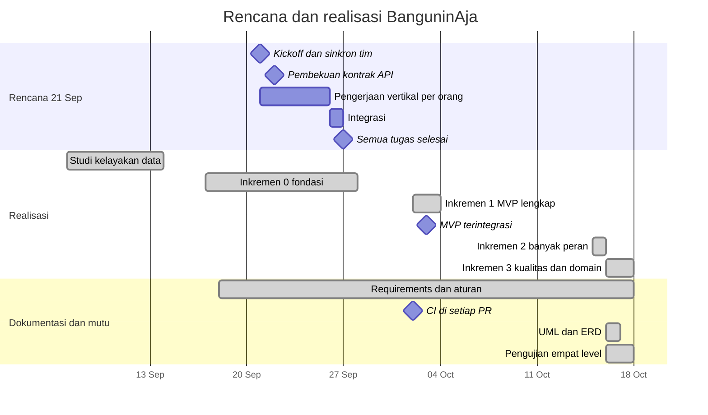

# Jadwal, WBS, dan Pembagian Kerja

Rencana diambil dari `PROJECT_HANDOFF.md` di repositori data (ditulis 21
September). Realisasi diambil dari tanggal commit dan pull request di kedua
repositori. Model prosesnya dijelaskan di [model SDLC](sdlc.md).

## 1. Gantt rencana dan realisasi

### Selisih rencana dan realisasi

| Hal | Rencana | Realisasi | Selisih |
|---|---|---|---|
| Aplikasi terintegrasi dan bisa didemokan | 27 September | 3 Oktober (#43) | 6 hari terlambat |
| Cakupan MVP | Tiga tab: Ringkasan, Analisis Lokasi, Keuangan | Semua modul ERP, termasuk Penjualan, Pengadaan, Inventaris, dan SDM yang semula P2 | Cakupan lebih luas dari rencana |
| Pembagian kerja | Lima vertikal paralel, satu orang satu fitur | Fondasi dikerjakan empat orang; inkremen 1 sampai 3 dikerjakan terutama oleh satu orang | Integrasi menumpuk di satu orang |
| Hari tanpa commit | Tidak direncanakan | 28 September sampai 1 Oktober, dan 4 sampai 14 Oktober | Dua jeda, pekerjaan berlanjut dalam beberapa hari yang padat |

## 2. Work Breakdown Structure

| Kode | Paket kerja | Status | Rujukan |
|---|---|---|---|
| **1** | **Data dan analisis lokasi** | | |
| 1.1 | Pengumpulan data nasional: BPS, InaRISK, ZNT, RDTR, Pusiknas, OSM | Selesai | Repositori data, 7 sampai 13 September |
| 1.2 | Layanan penilaian lokasi (Python, lima dimensi, bobot per profil bangunan) | Selesai | #7, #18 |
| 1.3 | Evaluasi lokasi, regulasi, dan berita | Selesai | Fondasi, #10, #58, #64, #70 |
| 1.4 | Peta, lapisan data, perbandingan, laporan PDF | Selesai | #6, #27, #28, #50 |
| **2** | **ERP proyek** | | |
| 2.1 | Proyek: tahap, RAB, izin, tim, progres berbobot, kurva S, laporan harian | Selesai | #13, #26, #48, #61, #65 |
| 2.2 | Kontrak kontraktor: termin, retensi, adendum | Selesai | #71, #72 |
| 2.3 | Keuangan: anggaran, kas, jurnal, buku besar | Selesai | #31, #38, #41 |
| 2.4 | Tagihan: faktur, piutang, hutang, pembayaran, on-chain | Selesai | #25, #36, #43, #52 |
| 2.5 | Penjualan: prospek, unit, kontrak, cicilan | Selesai | #14, #29, #35 |
| 2.6 | Pengadaan, inventaris, aset, dan alat | Selesai | #14, #16, #30, #34, #37 |
| 2.7 | SDM: karyawan, absensi, penggajian | Selesai | #16, #34 |
| 2.8 | Laporan PDF, XLSX, CSV | Selesai | #45 |
| **3** | **Platform** | | |
| 3.1 | Auth, sesi, dan hak akses 7 peran | Selesai | #1, #44, #51, #62, #68 |
| 3.2 | Data master | Selesai | #5, #49 |
| 3.3 | Docker, CI, demo online, pemeriksaan kerentanan | Selesai | Fondasi, #23, #66, #74 |
| **4** | **Dokumentasi dan mutu** | | |
| 4.1 | Requirements | Berjalan terus | [requirements](../requirements) |
| 4.2 | Desain UML dan ERD | Selesai | #55 |
| 4.3 | Pengujian unit, integration, system, acceptance | Selesai, 2 skenario acceptance belum dijalankan | #57, #66, #67 |
| 4.4 | Risiko, keamanan, etika | Selesai | #69 |
| 4.5 | Proses SDLC dan jadwal | Dokumen ini | |
| **5** | **Presentasi akhir** | Belum | |

## 3. Peran dan kontribusi

Rencana pembagian dari `PROJECT_HANDOFF.md` repositori data, dibandingkan
dengan penulis commit di kedua repositori sampai 17 Oktober. Jumlah commit tidak
mengukur seluruh kontribusi; pekerjaan seperti pengujian penerimaan dan
pengumpulan data di luar repositori tidak tercatat di sini.

| Anggota | Peran dalam rencana | Commit repositori data | Commit repositori aplikasi | Bagian yang tercatat di git |
|---|---|---|---|---|
| Derick (`draxmit`) | Pemilik produk; pembayaran on-chain | 14 | 189 | Seed data, layanan penilaian, peta, ruang kerja proyek, layar ERP sejak Oktober, CI, dokumentasi |
| Jonathan Andrew Saleh | Konteks deskriptif: regulasi simulasi, berita | 21 | 10 | Pengumpulan data, auth, skema database, Docker, kerangka frontend ERP |
| Moses (`nathanaelmosesES`) | Pipeline layanan penilaian | 0 | 1 commit, 2 PR | Lapisan service dan controller untuk semua slice, kerangka peta |
| Ian (`AnthonyBudiarto`) | Site intelligence: peta dan evaluasi lokasi | 0 | 5 | Regulasi, berita, evaluasi lokasi, halaman Analisis Lokasi |
| Erick | Frontend ERP | 0 | 0 | Belum ada commit atas namanya |

Untuk sisa pekerjaan (presentasi, skenario acceptance AT-10 dan AT-13, hak akses
per proyek), setiap anggota sebaiknya memegang tugasnya lewat branch dan PR
sendiri, dan setiap PR ditinjau minimal satu anggota lain.

## 4. Aktivitas per minggu

| Minggu | Commit repositori data | Commit repositori aplikasi | Penulis aktif |
|---|---|---|---|
| 7 sampai 13 September | 34 | 0 | 2 |
| 14 sampai 20 September | 0 | 8 | 1 |
| 21 sampai 27 September | 1 | 8 | 4 |
| 28 September sampai 4 Oktober | 0 | 107 | 1 |
| 5 sampai 11 Oktober | 0 | 0 | 0 |
| 12 sampai 18 Oktober | 0 | 82 | 1 |

Angka commit tanpa merge commit. Repositori aplikasi juga punya 104 merge commit
dari 72 pull request.
